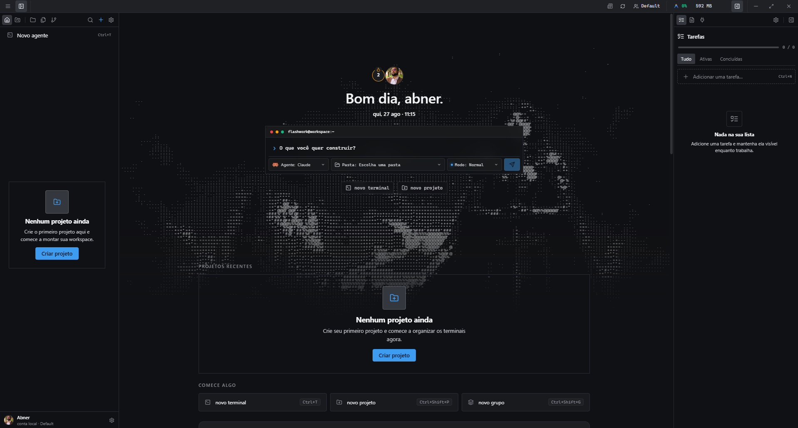
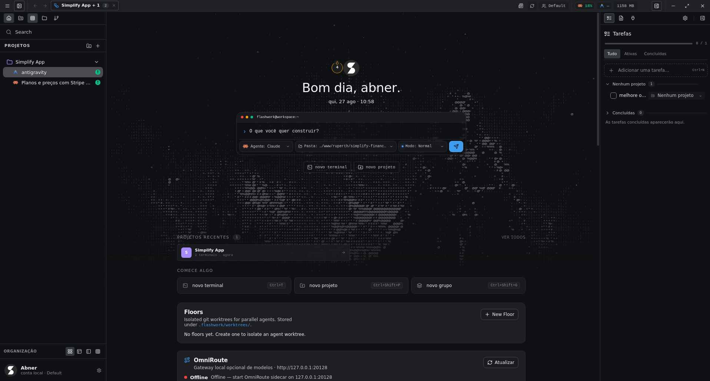
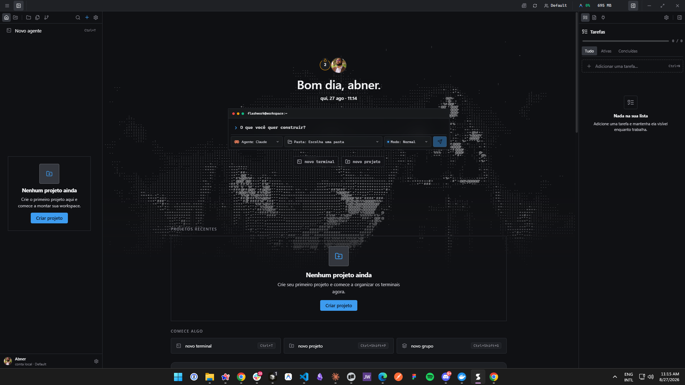
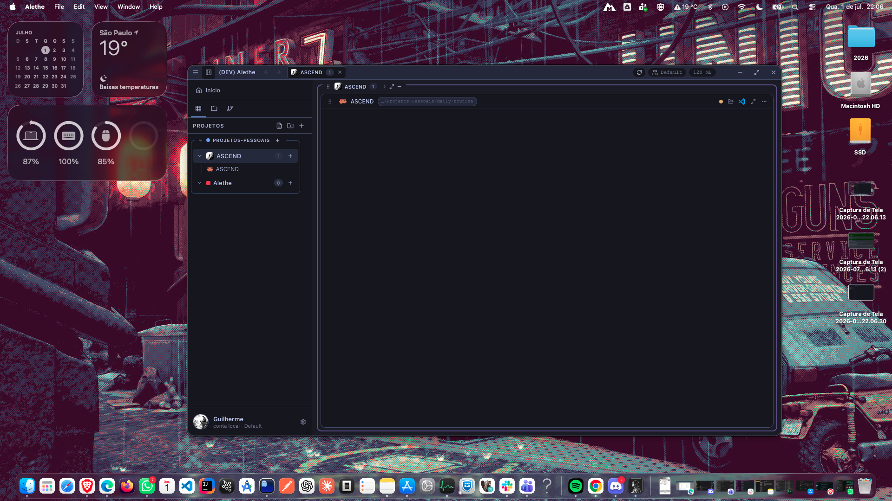

<p align="center">
  
</p>

<h1 align="center">Flashwork</h1>

<p align="center">
  <strong>Orquestrador desktop local-first de agentes de código em projetos.</strong><br>
  <em>Local-first desktop orchestrator for coding agents on disk projects — real PTYs, Graphify, and Run SPEC.</em>
</p>

<p align="center">
  
  
  
  
  
</p>

Flashwork é um app nativo (**Windows-first**, com builds para Linux e macOS) que trata cada pasta como um projeto com `.flashwork/`. Você cola um prompt ou anexa um `.md` em **Run SPEC**; o planner divide o trabalho em tarefas; e o Flashwork abre um CLI (ou shell) por tarefa, com PTYs reais — não terminais fake.

Os agentes compartilham `.flashwork/runs/<runId>/board.md` para não refazer o trabalho uns dos outros. Em todo projeto, o **Graphify** monta um grafo offline do código e entra nas sessões Claude, Codex, OpenCode e Gemini via MCP. Projetos em WSL rodam dentro da distro.

O produto é **local-first**. Projetos, preferências, layouts, histórico e chaves ficam na máquina. Não há sync em nuvem nem gateway tipo OpenRouter.

Derivado de [Flashwork Agents](https://github.com/abnerndr/flashwork-agents) (AGPL-3.0), com marca **Flashwork** / Ruperth.

> Tagline: **Reveal the state of every agent, shell, and project.** · Identificador: `com.ruperth.flashwork`

---

## Por que existe

Rodar vários agentes ao mesmo tempo vira caos: janelas soltas, SPEC sem plano, sessões que se perdem e nenhum lugar que mostre o que cada CLI está fazendo no mesmo projeto.

Flashwork concentra isso num workspace único:

- **Run SPEC** — prompt ou `.md` → plano → um pane por tarefa
- **Graphify** em todo projeto — grafo de código + MCP nos CLIs
- PTYs reais no backend Rust (`portable-pty`), renderizados com `xterm.js`
- layouts em split, grid e spotlight, com drag-and-drop
- scrollback e resume de sessão de agente no disco (processos vivos **não** sobrevivem a quit/crash)
- controle de memória (desligar um terminal, um projeto ou suspender um grupo)
- edição no **VS Code** (`Open in VS Code`) — sem workbench Monaco embutido

---

## Screenshots

<p align="center">
  
</p>

<p align="center">
  
</p>

<details>
<summary>Windows e macOS</summary>

<p align="center">
  
  
</p>

</details>

Preview animado: [`docs/assets/flashwork-preview.gif`](docs/assets/flashwork-preview.gif)

---

## Como funciona (fluxo principal)

```text
Pasta no disco
  └── .flashwork/          # harness, rag/STATUS, runs/, history/
        └── runs/<runId>/
              └── board.md # board compartilhado entre os CLIs do run

Run SPEC
  1. Cola um prompt ou anexa um/mais .md
  2. Planner: DeepSeek API (se houver chave) → Gemini CLI → heurística local
  3. Você revisa o plano (troca CLI, remove tarefas)
  4. Um pane por tarefa nos CLIs escolhidos (Claude, Codex, OpenCode, …)
     DeepSeek e Gemini são planner-only — não viram workers do SPEC
```

---

## O que faz

| Área | Capacidade |
| ---- | ---------- |
| **Run SPEC** | Prompt ou vários `.md`; plano revisável; um CLI/shell por tarefa; barra de progresso; requeue quando um CLI fica sem crédito; board em `.flashwork/runs/<runId>/board.md` |
| **Projeto** | Pasta escolhida pelo usuário + `.flashwork/`; pasta já com harness é reaberta, não duplicada |
| **Graphify** | Instalação e build offline na criação do projeto; MCP ligado em Claude, Codex, OpenCode e Gemini |
| **Agentes** | Shell, Claude Code, Codex, OpenCode, GitHub Copilot CLI, Gemini, Antigravity, Mimo, Freebuff; install/update cross-platform |
| **WSL** | Projetos e terminais dentro da distro via `wsl.exe`; Graphify e detecção de CLI no Linux |
| **Workspace** | Vários projetos abertos, containers, fullscreen, flat mode, restore de layout após restart |
| **Layouts** | Auto, Spotlight, Sidebar e grid custom (colSpan / rowSpan, frações redimensionáveis) |
| **Terminais** | Spawn, attach, resize, restart, kill; sub-abas; busca in-terminal; scrollback em disco |
| **Git** | Source Control estilo VS Code (stage, commit, fetch/pull/push, publish, PR no browser); worktrees opcionais |
| **MCP / Skills** | Marketplace unificado (Claude, Codex, OpenCode, Antigravity); install de skills; copiar config entre agentes |
| **Providers** | Chaves Anthropic, OpenAI, Gemini e DeepSeek no keyring do SO; DeepSeek só para o planner do Run SPEC |
| **Uso / tokens** | HUD de tokens (opcional) e faixa de uso na Home (Claude, Codex, Gemini, OpenCode, …) |
| **Memória** | Desabilitar terminal/projeto, suspender grupo, indicador de RAM |
| **Contas** | Vários perfis locais isolados |
| **Backup** | Export/import `.zip` com proteção contra zip-slip e writes atômicos |
| **i18n** | Inglês e pt-BR; o build falha se faltar chave de tradução |

Lista completa: [`docs/FEATURES.md`](docs/FEATURES.md) · histórico: [`docs/CHANGELOG.md`](docs/CHANGELOG.md)

---

## Stack

| Camada | Tecnologia |
| ------ | ---------- |
| Shell desktop | [Tauri 2](https://tauri.app/) |
| Backend | Rust (`portable-pty`, Tokio, serde, keyring, reqwest) |
| Frontend | React 18, TypeScript, Vite 6 |
| Estado | Zustand |
| Terminal | xterm.js + addons (fit, search, unicode11) |
| Layout / DnD | `react-resizable-panels`, `@dnd-kit/core` |
| Persistência | `projects.json` por perfil + `.flashwork/` no projeto + scrollback |
| Testes | Vitest (frontend) + `cargo test` (Rust) |
| CI | GitHub Actions: lint, testes e build do frontend |

Estilo via CSS Modules e design tokens (`theme.css`) — sem Tailwind.

---

## Modelo de domínio

```text
Group
└── Project (= pasta no disco + .flashwork/)
    └── Terminal / Pane
        ├── Shell tab
        ├── Claude Code tab
        ├── Codex tab
        └── …
```

- **Group** — coleção lógica de projetos (cor, ícone, suspend)
- **Project** — pasta no disco com harness `.flashwork/`, terminais, layout e runs
- **Pane / Container** — representação visual de um projeto aberto
- **Terminal** — unidade persistente: cwd, sub-abas, PTY, scrollback
- **Sub-tab** — aba interna (agente ou shell)
- **Run SPEC** — plano + panes + `board.md` sob `.flashwork/runs/`

Detalhes: [`docs/OVERVIEW.md`](docs/OVERVIEW.md)

---

## Requisitos

| Requisito | Notas |
| --------- | ----- |
| **Node.js ≥ 22** | Definido em `package.json` `engines` |
| **pnpm** | Instalado pelo setup (Corepack) |
| **Rust (stable)** | Via [rustup](https://rustup.rs) |
| **Toolchain nativo** | Deps do Tauri (instaladas pelo setup) |

### Setup (todos os SOs)

Um comando na raiz — detecta o SO, instala pnpm, Rust, pacotes do Tauri e as deps do app:

```bash
# Precisa de Node.js >= 22 já instalado.
node scripts/setup.mjs
# ou, se pnpm já existir:
pnpm run setup
```

Atalhos por SO (mesmo script por baixo):

```bash
./scripts/setup-linux.sh      # Ubuntu/Debian e WSL (apt + webkit/gtk)
./scripts/setup-macos.sh      # Xcode CLT
.\scripts\setup-windows.ps1   # checa MSVC / WebView2; rustup via winget se faltar
```

Só deps do repo (sem apt/Xcode): `pnpm run setup:deps`.

---

## Rodar

Na raiz do repositório:

```bash
pnpm run setup         # bootstrap completo (primeira vez)
pnpm run test:local    # lint + testes + build do frontend
pnpm run app           # abre o app (Tauri) — teste local
pnpm run dev:ui        # só o visual no browser (sem PTY)
```

A primeira execução de `pnpm run app` compila o backend Rust do zero e leva alguns minutos. As seguintes são rápidas.

`dev:ui` sobe só o Vite — útil para UI, mas **não** spawna PTYs.

### Instalador (rode no SO correspondente)

```bash
pnpm run installer:linux      # AppImage + .deb
pnpm run installer:macos      # .dmg + .app
pnpm run installer:windows    # NSIS + MSI
pnpm run installer            # bundle do SO atual
```

Artefatos: `src-tauri/target/release/bundle/`

Windows é a plataforma mais testada. Linux e macOS entram no fluxo de release; validação em máquina real ainda é bem-vinda.

---

## Estrutura

```text
src/                   # React frontend
src-tauri/             # Rust / Tauri backend
docs/                  # Product docs, specs, plans, screenshots
scripts/               # Setup, development, build, release helpers
.github/workflows/     # CI and releases
```

---

## Documentação

| Doc | Conteúdo |
| --- | -------- |
| [`FEATURES.md`](docs/FEATURES.md) | Capacidades do produto |
| [`OVERVIEW.md`](docs/OVERVIEW.md) | Modelo de domínio, stack, persistência |
| [`CHANGELOG.md`](docs/CHANGELOG.md) | Histórico user-facing |
| [`CONTRIBUTING.md`](CONTRIBUTING.md) | Setup, convenções, PRs |
| [`BRAND.md`](docs/BRAND.md) | Tokens visuais e assets |
| [`AGENTS.md`](AGENTS.md) | Guia de trabalho para agentes de código |

---

## Licença

The desktop app and generated binaries are **AGPL-3.0-or-later**; see `LICENSE`. Original repository helper scripts and program documentation retain their MIT terms in `LICENSE-MIT`.

Ver:

- [`LICENSE`](LICENSE)
- [`NOTICE`](NOTICE)
- [`TRADEMARK.md`](TRADEMARK.md)

Upstream: [Flashwork Agents](https://github.com/abnerndr/flashwork-agents)

---

## Autor

**Abner Ananias** — [Ruperth](https://github.com/abnerndr) · identificador do app `com.ruperth.flashwork`
